<div align="center">

# AstroDocX

**Astronaut + Doctor + X** — an offline-first health co-pilot for astronauts on long-duration missions.

NASA Space Apps Challenge 2026 · *Create Health Monitoring Software for Astronauts on Space Missions*<br>
Team AstroDocX · Mymensingh, Bangladesh


### ▶ [Take the 1-click tour (2 min)](https://astrodocx.vercel.app/?tour=full)

[Live site](https://astrodocx.vercel.app) · [Crew Console](https://astrodocx.vercel.app/app/) · [3D Cabin](https://astrodocx.vercel.app/app/cabin) · [Crew Doctor](https://astrodocx.vercel.app/app/doctor) · [Video](https://youtu.be/RW1KRrJToUs)

</div>

No time to click around? The tour link plays the whole project by itself: NOVA's mission briefing on the homepage, the Crew Console's main screens with a live CO₂ fault demo, and the 3D cabin out to the astronaut on EVA. Pause, skip or exit any time from the bar at the bottom.

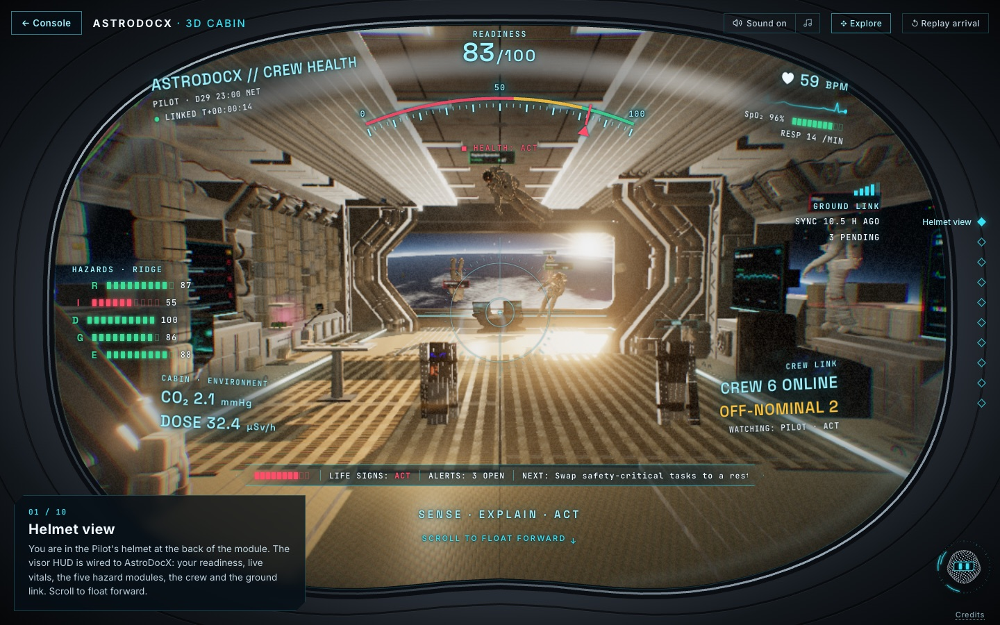

## Contents
1. [The problem](#the-problem)
2. [Our solution](#our-solution)
3. [How it fits together](#how-it-fits-together)
4. [The website, page by page](#the-website-page-by-page)
   - [Homepage: mission briefing with NOVA](#homepage-mission-briefing-with-nova)
   - [NASA Library](#nasa-library)
   - [The story page](#the-story-page)
   - [Crew Console](#crew-console)
   - [VITA, the AI crew doctor](#vita-the-ai-crew-doctor)
   - [3D Cabin](#3d-cabin)
5. [Sensors and IoT](#sensors-and-iot)
6. [On-device machine learning](#on-device-machine-learning)
7. [Sound, voices and the guided tour](#sound-voices-and-the-guided-tour)
8. [Feature reference](#feature-reference)
9. [Try it](#try-it)
10. [Run locally](#run-locally) · [Deploy](#deploy) · [Optional services](#optional-services)
11. [Tech stack](#tech-stack) · [Project structure](#project-structure)
12. [Use of AI](#use-of-ai) · [NASA data used](#nasa-data-used) · [Credits](#credits) · [License](#license)

## The problem
Long-duration missions expose astronauts to the five spaceflight hazards NASA groups as **RIDGE**:

- **R**adiation
- **I**solation and confinement
- **D**istance from Earth
- **G**ravity (altered)
- Hostile, closed **E**nvironments

These can bring immune changes, bone and muscle loss, cardiovascular events and behavioral health problems. Beyond the Moon, a message to Earth can take minutes each way, so the crew has to spot these changes in themselves and decide what to do.

## Our solution
AstroDocX learns each astronaut's **personal baseline**, spots drift early, and turns every alert into a **clear action** the crew can take on their own:

**Detect → Explain → Act → Log → Sync later**

| | |
|---|---|
| 🛰️ **Website** | A briefing homepage with **NOVA**, a mission guide who answers from NASA sources, a NASA media library and a scroll-driven particle story |
| 🩺 **Crew Console** | An installable, offline PWA: Status Board, alerts with action cards, trends, daily check-in, simulator, delay-tolerant ground sync, a flight-surgeon view and the NASA basis of every check |
| 🤖 **VITA** | The AI crew doctor: a 3D doctor with lip sync who examines the whole crew, triages, clears people for EVA and writes the ground handoff, plus a chat dock on every console page |
| 🚀 **3D Cabin** | A walk through an ISS-style module driven by live data: a visor HUD, six crew with live name tags, robots, wall screens that run the real console, and an EVA outside |
| ⌚ **Sensors / IoT** | A webcam face scan (rPPG), the X-Ray Mirror, a Haylou Solar 5 smartwatch over Web Bluetooth, simulated Wi-Fi sensing and ultrasound, plus an optional Supabase ground server |
| 🧠 **On-device ML** | Isolation Forest anomalies, a Holt-Winters heart-rate band, a readiness score and watch-vs-webcam agreement, all in the browser and kept out of the alert engine |

> **Status (12 Nov 2026):** the homepage with its guide NOVA, the **Crew Console** (`app/`) with its 3D Cabin, VITA the crew doctor, face scan, X-Ray Mirror, watch link, on-device insights, voice navigation, the simulated Wi-Fi Sensing and Ultrasound screens, and the NASA Library are all built and run the full loop. The console passes 578 tests (89 files). AstroDocX is a prototype, **not a medical device**; all thresholds not cited in the code are illustrative. The measured data in the app is the Inspiration4 lab panel on the NASA Data screen, plus whatever you record yourself with the face scan or a connected watch (kept on your device); live vitals, cabin readings and the demo mission are synthetic.

**Two guides, two names.** **NOVA** hosts the homepage briefing and the NASA Library. **VITA** is the crew doctor inside the console and the 3D cabin. **MEDI** is VITA's silent robot helper in the cabin.

## How it fits together

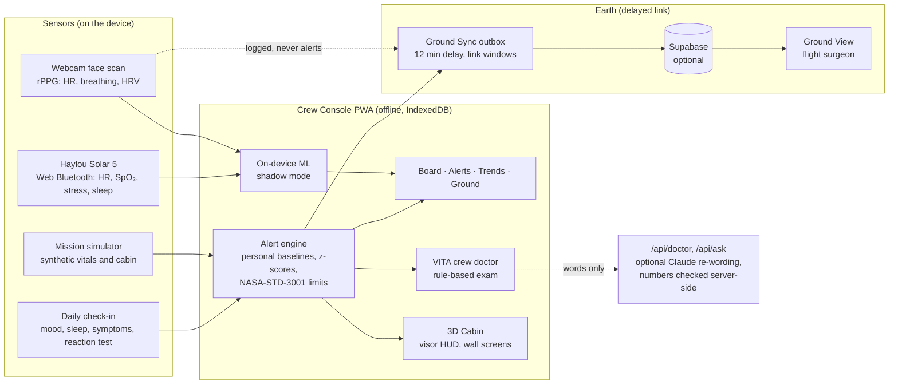

Every number, alert, finding and step comes from tested, deterministic code. The watch feeds only the ML insights, never the alert engine, and the live AI layer may only re-word what the engine and VITA's exam already said.

## The website, page by page

### Homepage: mission briefing with NOVA
The site opens in a single-screen briefing room. **NOVA**, our mission guide (a particle drone with a visor that follows your pointer), gives a 30-second intro once per visit, then answers questions about astronaut health, NASA research and AstroDocX itself, **with citations**. Type or use the microphone; with Sound on, NOVA speaks her answers.

- Answers come from a knowledge base generated from the engine and this README, plus 40 hand-written offline answers, so she works **with no network**.
- With an API key on the server, answers are re-worded live by Claude through `/api/ask`, but only from cited sources; the server drops any URL or action that is not in the knowledge base.
- Answers can carry actions: open a console screen, jump to the cabin or the EVA, open a library collection, or start the tour.
- Three doors lead to the **Crew Console**, the **3D Cabin** and the **NASA Library**. It works with reduced motion.

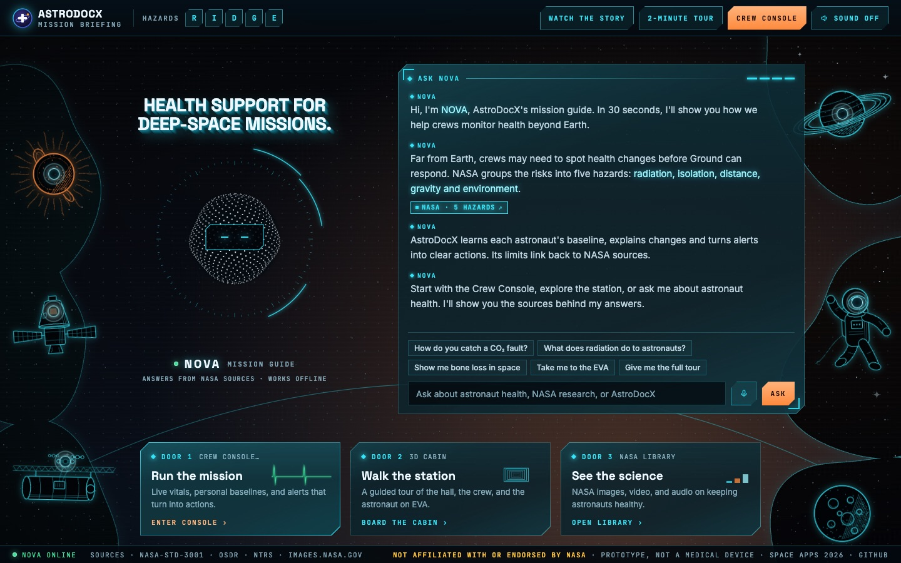

### NASA Library
Door 3 opens a curated, searchable library of NASA images, video and audio on astronaut health, pulled live from NASA's Image and Video Library with credit and links. Six collections: bone and muscle, radiation, sleep and isolation, the Twins Study, life support, spacewalks. NOVA introduces each one.

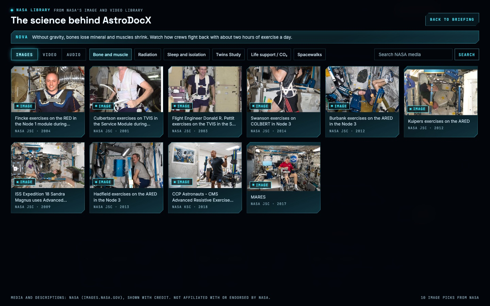

### The story page
The original scroll journey at [`/story.html`](https://astrodocx.vercel.app/story.html) (*Watch the story* on the homepage): one WebGL particle system of 24,000 points that becomes stardust, a planet, an astronaut saluting the flag on the Moon, Orion, a relay satellite and Earth, then the Health Twin and finally the AstroDocX wordmark.

| Intro | Crew: on the Moon |
|---|---|
|  |  |

| Health Twin | AstroDocX |
|---|---|
|  |  |

### Crew Console
The heart of AstroDocX at `/app/`: an installable, offline-first PWA for a crew of six, with a 30-day demo mission preloaded (synthetic data). The top bar switches crew member; everything below follows them.

**Status Board.** Readiness, the five RIDGE modules, a 3D Health Twin whose organs light up per hazard, live vitals and the next action.


| Alerts and action cards | Trends |
|---|---|
|  |  |
| Each alert says what changed, by how much, against whose baseline and since when, cites NASA evidence, and comes with checkable steps. | 11 metrics with the personal band, alert markers and 24 h / 7 d / 30 d views. |

| Daily check-in and face scan | Mission simulator |
|---|---|
|  |  |
| An optional webcam scan, then mood, sleep, symptoms and a reaction test. | Inject a solar event, a CO₂ fault, insomnia or deconditioning and watch the engine react. |

| Ground Sync | Ground View |
|---|---|
|  |  |
| A delay-tolerant outbox: link windows, a 12-minute delay, blackouts, CSV export. | What the flight surgeon on Earth can see, rebuilt only from synced entries. |

**NASA Data.** The NASA basis of the console in one screen: for each hazard, what is monitored, the NASA-STD-3001 limit checked and the studies cited, plus real Inspiration4 crew lab values charted against each person's own pre-flight baseline.

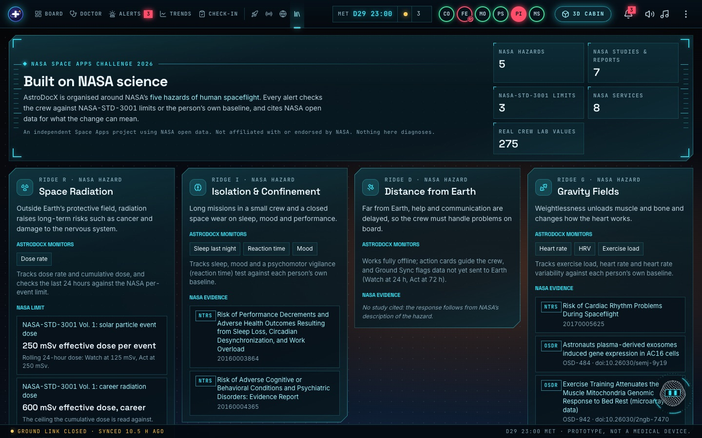

**Wi-Fi Sensing and Ultrasound (simulated).** Two contactless and imaging ideas from the research notes, built as working prototypes on simulated signals. *Wi-Fi Sensing* (`/app/rf`) models what a two-antenna receiver would see as a crew member breathes (52 subcarriers, random phase offsets, a static room far stronger than the breath) and runs the real pipeline on it: conjugate-ratio, Hampel filter, subcarrier merge, spectral peak. It reads breathing rate, presence and breathing pauses, and **holds back with a reason** when a crewmate is moving or the body is drifting. A sustained change suggests the right ultrasound exam. A **cabin sweep** extends this to the whole module: simulated link disturbances between routers are turned into a plan-view heat map by tomography, with tracked crew and plain-words activity labels. The same data drives a **3D Wi-Fi sensing view** (a dot-cloud hall, heat-shape crew, routers and waves, and a detection HUD), embedded in the Wi-Fi Sensing page and available from the 3D cabin. *Ultrasound* (`/app/ultrasound`) is a guided scan of the heart, neck vessels, lungs, thigh muscle and eye: a procedural B-mode picture, a probe you steer toward a good view (arrow keys, or the assisted hand), automatic capture once the view holds, then measurements against the person's own preflight values. The probe sites are pinned in 3D on the health twin's anatomical body (skeleton, organs, arteries, beating heart) that turns gently, and the scanned organ lights up (an SVG anatomy stands in without WebGL). Both are labelled simulated, log plain-words entries for Ground and never raise alerts or change baselines.

**X-Ray Mirror** (`/app/xray`). A full-screen camera mirror: MediaPipe face and hand tracking drive a 3D overlay of the skull, jaw, brain, face muscles and hand bones that follows you live. A settings drawer controls layers, look, fit and tracking; anatomy name tags label what you see and you can take a snapshot. A vitals card reads heart rate, HRV and breathing from the same video with the Face Scan's rPPG pipeline (skin patches placed from the face landmarks), and a finished reading can be saved to the Face Scan store. Everything runs on the device; the trackers and models are cached on first start and kept out of the service-worker precache.

The live waves on the board (ECG, pulse oximeter, breathing) are **simulated telemetry** built around the latest real readings; they never change alerts.

### VITA, the AI crew doctor
VITA reads every crew member's alerts, baselines, readiness, dose and the ground link **together**, and tells you what matters and what to do next.

- **The exam is rules, not a language model.** One finding per open alert; the same CO₂ or dose alert on two or more crew becomes one **cabin-wide** finding; fatigue clusters add a schedule change; crew are put in **triage order**; each person gets an **EVA clearance** check; steps are grouped *now / today / next link window*; metrics drifting with no alert yet go on a watchlist.
- **Three report styles:** Brief (spoken), Clinical (every finding, with numbers) and **SBAR ground handoff** for the flight surgeon, which you can add to the ground log so it reaches Earth with the next sync.
- **A 3D doctor** (Microsoft Rocketbox model) rises out of a holo pedestal, plays motion-capture idle, listening and talking clips, and **lip-syncs** to the browser's speech engine with visemes timed per word.
- **Ask her** who needs attention first, whether the crew is fit for EVA tomorrow, or how the Pilot is sleeping; follow-ups are answered offline from the same exam.
- **Optional live layer:** `/api/doctor` lets Claude re-word the exam. The server rejects any reply that names a crew member or quotes a number the exam does not contain, so the console falls back to its own words.

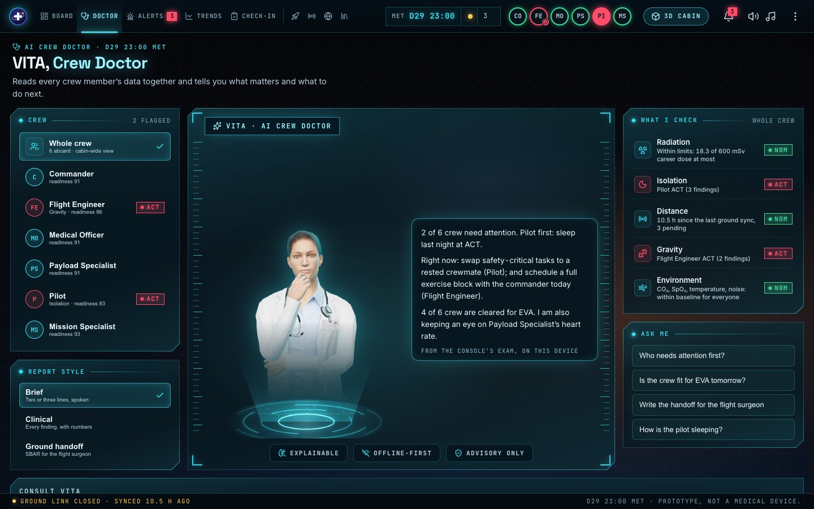

**VITA on every page.** A chat dock (the drone in the corner) answers questions about astronaut health or the project from any console screen, with NASA citations and buttons that take you to the right screen. It can start the full tour, and it listens if you use the microphone.

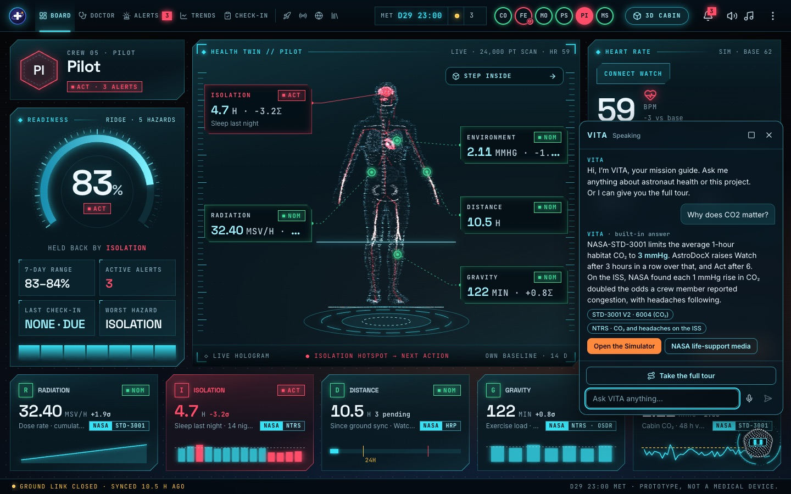

### 3D Cabin
A walk through a lived-in ISS-style module at `/app/cabin`, driven by the console's live data. Scroll (or use the arrow keys or the stop list) to float through ten camera stops, from inside the Pilot's helmet to a crew member on EVA beside the station.

- **Helmet visor HUD** wired to AstroDocX: readiness, live vitals, the five hazard modules, cabin CO₂ and dose, the crew link and the ground link (top of this README).
- **Six crew** floating at work, each with a live name tag (heart rate and status from the same engine).
- **Four wall screens running the real console.** Press *Use this screen* to work the Status Board, vitals, alerts or trends inside the 3D scene.
- **The robots VITA and MEDI** patrol the hall; VITA's robot turns to face you and speaks the doctor's brief.
- NASA Visible Earth through the window, touch and float-mode controls, synthesised cabin hum and a score.
- **Works on phones and slower devices.** Portrait camera stops frame the wall screen or astronaut large above the caption, the visor HUD becomes compact blocks, and the caption clamps with a *More* button. Quality is picked from the GPU's name, frames are capped at 60 fps, and the cabin steps down (ambient occlusion, Retina pixels, shadows, bloom, antialiasing, resolution, then 30 fps) while frames stay slow, remembering the tier for next time. Wall-screen iframes load only when the camera comes near. The landing page and console adapt the same way.

| Crew overview | A wall screen running the console |
|---|---|
| 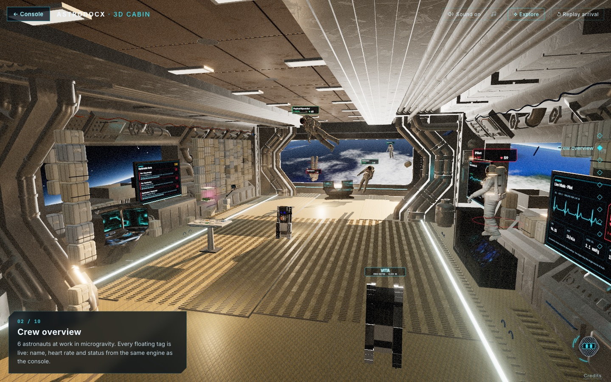 | 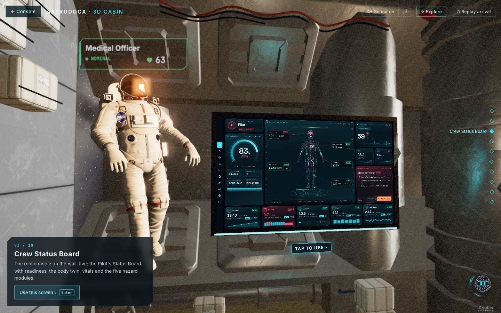 |

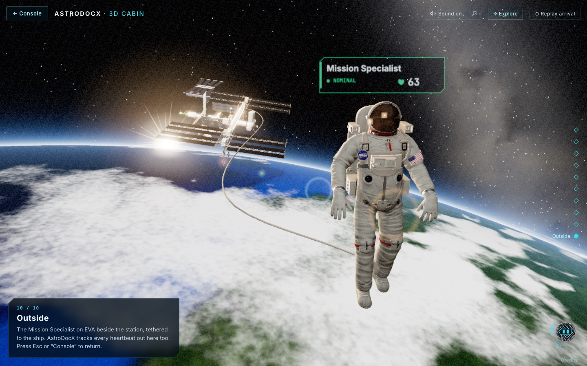

## Sensors and IoT
AstroDocX takes real measurements from hardware you already have. Everything runs in the browser; nothing is sent anywhere unless you set up the optional ground server.

| Device | Link | What it measures | Where it goes |
|---|---|---|---|
| **Webcam** (face scan) | `getUserMedia`, video never leaves the device | Heart rate, breathing rate and a rough HRV from the colour change of facial skin (rPPG, POS method), each with a signal-quality score | Logged as check-in context for the ground; never raises alerts or changes baselines |
| **Webcam** (X-Ray Mirror) | `getUserMedia` plus MediaPipe face and hand landmarkers, all on device | A live 3D anatomy overlay, and the same rPPG heart rate, HRV and breathing as the face scan | Optionally saved to the Face Scan store; never raises alerts |
| **Haylou Solar 5 smartwatch** | **Web Bluetooth** (Chrome or Edge, desktop or Android) with our own frame decoder; access limited to the watch's one data service | Live heart rate and SpO₂, plus its stored stress and sleep-stage history | The live heart-rate card, and (only if you switch on *Save watch data on this device*) the on-device ML insights; exportable as CSV or JSON, erasable in one click |
| **Wi-Fi CSI** (not connected) | A browser cannot read Channel State Information. An ESP32 or Raspberry Pi that exposes CSI could feed `estimate()` in `src/rf/dsp.ts`, which is written to take real frames | Breathing, presence and movement without a worn sensor; simulated today | Shown on the Wi-Fi Sensing screen; never raises alerts |
| **Ultrasound probe** (not connected) | A real probe would deliver frames through its vendor SDK or DICOM; `src/ultrasound/render.ts` is the part it would replace | Heart, vessels, lungs, muscle and optic nerve sheath; simulated today | Saved scans and a log entry for Ground; never raises alerts |
| **Ground server** (optional) | Supabase over HTTPS, only inside link windows | The synced crew log | Ground View on any other computer, for a flight surgeon on Earth |

The watch is linked to one crew member when saving is on, and its data lives in its own IndexedDB store that the alert engine never reads, so a wrist artefact cannot raise a medical alert.

## On-device machine learning
From saved watch data, the Trends screen adds **Wearable Insights**. All four models are plain TypeScript with a seeded PRNG: no ML runtime, no network, no cloud inference. They run in **shadow mode**: shown with clear labels, never wired into the alert engine.

| Model | Method | Output | Warm-up |
|---|---|---|---|
| Personal anomaly detector | Isolation Forest (100 trees) plus robust MAD z-scores, scored walk-forward | A daily anomaly strip | 14 good-quality days |
| Heart-rate forecast | Additive Holt-Winters with 24-hour seasonality, ±1.96σ band | Hours that are unusual for this time of day | 72 hours |
| Readiness score | Transparent components (resting HR, sleep, SpO₂, stress), then a personal ridge regression on your own check-ins | A 0–100 daily score | 7 good-quality days |
| Watch vs face scan | Bland-Altman agreement within ±60 s | How far the webcam and the watch agree | 3 paired readings |

On a 60-day synthetic benchmark (out-of-sample) the anomaly detector reached precision 0.82–0.89 and recall 0.89–1.00 with at most 0.38 false alarms per week, and the forecast's MAE was 2.7 bpm. These are an upper bound, not a measure on real watch data. Details, features and limits: the [model card](docs/ml-model-card.md).

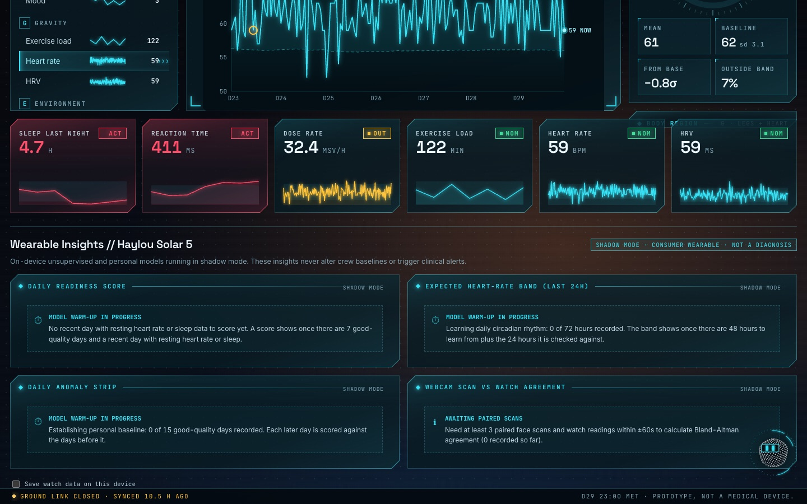

## Sound, voices and the guided tour
- **Sound:** everything is synthesised with the Web Audio API, with no audio files: glass-bell interface sounds, Quindar radio tones, generated score beds per screen that duck under speech, and a distinct speaking voice for each crew role, VITA, MEDI and NOVA.
- **Guided tour:** one link (`/?tour=full`) plays the homepage briefing, the console's main screens with a live CO₂ fault, and the cabin out to the EVA. VITA narrates every stop, captions match the voice, and you can pause, skip or exit at any time.

## Feature reference
The complete list of what the console does today. (NOVA's and VITA's knowledge base is generated from this table, the tagline and the roadmap line below, so keep them in this format.)

| Area | What the Crew Console really does |
|---|---|
| Personal baselines | Learns each astronaut's own normal for 11 metrics (HR, HRV, SpO₂, sleep, exercise, reaction time, mood, CO₂, cabin temperature, noise, radiation dose) with Welford + EWMA; it only learns while nominal, so slow drift is not "learned away" |
| Detection | Smoothed z-scores plus cited absolute limits (NASA-STD-3001 CO₂ and dose), persistence (2–3 readings in a row) and two-signal rules (sleep + reaction); Nominal / Watch / Act with hysteresis |
| Explainable alerts | Each alert says what changed, by how much, against whose baseline and since when, and links the published NASA evidence behind it (OSDR studies with DOIs, Human Research Program reports on NTRS); context, never a diagnosis |
| Action cards | Checkable countermeasure steps with progress and Done; open → escalate → ease → resolve lifecycle, all logged |
| Status Board | Five RIDGE tiles, crew readiness score, crew overview, next action, live vitals strip (ECG-style waves, heart pulse) |
| Crew Doctor (VITA) | VITA reads every crew member's alerts, baselines, readiness, dose and the ground link together: one cabin-wide finding when the same CO₂ or dose alert hits two or more crew, fatigue clusters, triage order and an EVA screen per person, with steps grouped now / today / next link window. Brief, clinical or SBAR ground-handoff wording, read aloud, added to the ground log; an optional live layer (Claude, `/api/doctor`) only re-words that exam, and the server rejects any number or crew member the exam does not contain. In the 3D cabin the VITA robot speaks the same brief |
| Health Twin (console) | A 3D particle body (the same baked human as the landing page) turning gently: the heart beats with the live ECG, a pulse runs down the arteries, and each hazard colours its own part (brain, lungs, legs, skin, transmitter arm) amber or red |
| Trends | 11 charts with the personal baseline band, alert markers, 24 h / 7 d / 30 d |
| Daily Check-in | Opens on an optional face scan (below), then mood, sleep quality, hours slept, 8 symptom chips and a 5-tap reaction test (PVT-style); symptoms and sleep quality raise alerts |
| Face scan (experimental) | A 30-second webcam scan estimates heart rate, breathing and a rough HRV from the tiny colour change of facial skin (remote photoplethysmography, POS method), each with a quality score. The video never leaves the device and only the numbers are kept. A webcam is not a medical sensor: scans are context, never a diagnosis |
| X-Ray Mirror | A full-screen camera mirror at `/app/xray`: face and hand tracking (MediaPipe, on device) drive a 3D overlay of skull, jaw, brain, face muscles and hand bones, with layers, look and fit settings, anatomy name tags and a snapshot. A vitals card reads heart rate, HRV and breathing from the same video with the face-scan pipeline and can save the reading |
| Wi-Fi Sensing (simulated) | `/app/rf`: a simulated two-antenna Wi-Fi CSI receiver and the real pipeline on it (conjugate ratio, Hampel filter, subcarrier merge, spectral peak) read breathing rate, presence and pauses, and hold back with a reason when a crewmate moves. A cabin sweep maps simulated link disturbances to a plan-view heat map with tracked crew, and a 3D Wi-Fi sensing view shows the hall as a dot cloud. Logged for Ground, never raises alerts |
| Ultrasound (simulated) | `/app/ultrasound`: five guided exams (heart, neck vessels, lungs, thigh muscle, eye) with a procedural B-mode picture, a steerable probe, automatic capture, measurements against the person's preflight values, scan history, and a flag for the flight surgeon. Probe sites are pinned on the 3D anatomical body. Never raises alerts |
| Watch (experimental) | Connect a Haylou Solar 5 smartwatch over Web Bluetooth (Chrome or Edge) for live heart rate and SpO₂, plus its stored stress and sleep history. Nothing is saved unless you switch on *Save watch data on this device*; saved data is linked to one crew member, exportable as CSV or JSON and erasable in one click |
| On-device insights (shadow mode) | From saved watch data, in the Trends screen: a personal anomaly detector (Isolation Forest plus robust z-scores, scored walk-forward), a 24-hour heart-rate forecast band (Holt-Winters), a transparent readiness score and a watch-vs-face-scan agreement check. All of it runs in the browser and is **never wired into the alert engine**, so a wrist artefact cannot raise a medical alert. See the [model card](docs/ml-model-card.md) |
| 3D Cabin | A walk through a lived-in ISS-style module at `/app/cabin`, from the helmet view out to the astronaut on EVA, driven by the console's live data: a crew of six with name tags, the robots VITA and MEDI patrolling the hall, wall screens that run real console pages, a helmet-visor HUD tied to the health monitor, NASA Visible Earth in the window, touch and float-mode controls |
| Guided tour | One link (`/?tour=full`) plays the homepage briefing, the console's main screens with a live CO₂ fault, and the cabin out to the EVA; VITA narrates every stop, captions match the voice, and you can pause, skip or exit at any time |
| Sound | Everything is synthesised in the browser, no audio files: glass-bell interface sounds, Quindar radio tones, generated score beds per screen that duck under speech, and a distinct speaking voice for each crew role, VITA, MEDI and NOVA. One Sound switch per page (remembered in the browser, shared with the homepage); the score is a separate opt-in |
| NASA Library | A curated, searchable library of NASA images, video and audio on astronaut health (six collections: bone and muscle, radiation, sleep and isolation, the Twins Study, life support, spacewalks), pulled live from NASA's Image and Video Library with credit and links |
| Mission Simulator | Mission clock, fast-forward, 4 injectable scenarios (solar event, CO₂ fault, insomnia, deconditioning); watch the engine react |
| Ground Sync | Delay-tolerant outbox: link windows, 12-minute delay, blackout, auto-sync, CSV log export |
| Ground View | Flight-surgeon view rebuilt only from synced entries (shows what Earth knows, and when); each crew card shows the 3D body in its status colour |
| NASA Data | The NASA basis of the console in one screen: for each of NASA's five hazards, what AstroDocX monitors, the NASA-STD-3001 limit it checks and the NASA studies cited; every alert and Status Board tile carries a NASA source tag. Also a **Real crew data** panel: measured blood counts, metabolic and inflammation markers from the four SpaceX Inspiration4 crew (NASA OSDR OSD-569 and OSD-575), each person charted against their own pre-flight baseline and the lab reference range |
| Platform | Offline-first installable PWA that adapts its quality to slower devices and phones, IndexedDB on the device, 6-crew 30-day demo mission preloaded |

**Not built yet (Roadmap):** support for more wearables than the one watch, wearable data feeding the alert engine (today it stays in shadow mode), a real Supabase ground backend with proper policies, vision/SANS self-tests, blood pressure, bone density, a multi-device ground station.

## Try it
| Where | What to do |
|---|---|
| **Homepage** ([`/`](https://astrodocx.vercel.app)) | Listen to NOVA's 30-second intro (or Skip), then ask a question such as *What does radiation do to astronauts?* |
| **1-click tour** ([`/?tour=full`](https://astrodocx.vercel.app/?tour=full)) | A guided two-minute run: NOVA's briefing, then the console and the 3D cabin with VITA. Space pauses, Esc exits, a scroll or click pauses so you can look closer |
| **3D Cabin** ([`/app/cabin`](https://astrodocx.vercel.app/app/cabin)) | Scroll to fly from the helmet view through the hall to the EVA; the wall screens are live console pages and the visor HUD follows the selected crew member's status. Works on touch |
| **Crew Doctor** ([`/app/doctor`](https://astrodocx.vercel.app/app/doctor)) | Ask VITA for the cabin-wide exam, switch between Brief, Clinical and SBAR wording, or add the handoff to the ground log |
| **Voice navigation** (mic button or `Alt+V`, on the homepage, console, cabin and story page) | Say “open alerts”, “walk the station”, “open the radiation library”, “go back”, “scroll down” or “take the tour”. Voice mode keeps listening until you say “stop listening”; anything that is not a command goes to NOVA or VITA as a question. Needs browser speech recognition (Chrome, Edge, Safari) |
| **VITA dock** (any console page) | Open the drone in the bottom-right corner and ask anything, or press *Take the full tour* |
| **Run demo** (console, top bar `⋯` menu) | Injects a CO₂ scrubber fault; watch the board, twin and alerts react (about 20 s). *Reset demo* restores the mission data |
| **Mission Simulator** ([`/app/simulator`](https://astrodocx.vercel.app/app/simulator)) | Inject a scenario for one crew member or the whole crew, tick the action-card steps on Alerts, then sync the log from Ground Sync in the next link window |
| **Face scan** ([`/app/checkin`](https://astrodocx.vercel.app/app/checkin)) | Allow the camera for a 30-second scan, or skip straight to the questions. Use good, even light and sit still |
| **Watch** (Status Board, then Trends) | *Connect watch* in the live vitals strip needs a Haylou Solar 5 and a browser with Web Bluetooth (desktop or Android Chrome or Edge, over HTTPS or localhost). The *Watch data* panel and the insights are on the Trends screen. Without a watch, everything else works as before |
| **Story** ([`/story.html`](https://astrodocx.vercel.app/story.html)) | Scroll through the journey. In the Health Twin section the scan runs head to feet, six system panels appear, Crew Readiness counts up, then the Pilot's real Act alert from the demo mission appears as an action card |
| **NASA Library** (homepage, Door 3) | Pick a collection or search NASA's media |

## Run locally
**Crew Console** (needs Node 22):

```bash
cd app
npm install
npm run dev      # http://localhost:5173/app/
npm test         # 578 tests in 89 files (engine, ML, UI, DB, cabin, doctor, rf, ultrasound, xray, voice)
npm run lint     # oxlint
npm run build && npm run preview   # production build with the service worker, to test install and offline
```

**Landing site** (the briefing homepage, the story page and the NASA Library) is static, with no build step. To run it together with a built console, use the local server, which falls back to the console's `index.html` for deep links such as `/app/cabin`:

```bash
cd app && npm run build && rm -rf ../landing/app && cp -r dist ../landing/app && cd ..
python3 tools/landing-server.py      # http://localhost:5180 (landing at /, console at /app/)
```

For the landing page alone, `cd landing && python3 -m http.server 8000` is enough.

**VITA and NOVA tests** (offline matcher, knowledge builder, live endpoints with a mocked client):

```bash
node --test tools/vita/test/*.test.mjs
python3 -m venv /tmp/vita-py && /tmp/vita-py/bin/pip install -r api/requirements.txt pytest
/tmp/vita-py/bin/python -m pytest tools/vita/test
```

NOVA's and VITA's knowledge base (`knowledge/`) is generated from the engine, the feature table, the tagline and the roadmap line in this README, so keep those three in their current format; how to rebuild it is in [`docs/vita.md`](docs/vita.md).

**Record the project video (tour mode).** Open the story page with `?tour=1` (for example `http://localhost:8000/story.html?tour=1`; `/?tour=1` forwards there) and it plays the journey by itself, pausing on every scene and Health Twin stage, so a screen recording is smooth. The cursor and back-to-top button are hidden. Options: `&speed=1.25` (faster), `&delay=5` (lead-in seconds). Keys: Space pause, R restart, Esc stop; any mouse wheel or touch also stops it. Hold times per scene are `tour` in `landing/universe/scenes.js`.

## Deploy
**Vercel (the live site).** `vercel.json` installs and builds the console in `app/`, copies it to `landing/app/`, and serves `landing/` as the output, with the `/app/*` SPA fallback, security headers and no-cache for `sw.js`. It also deploys the Python functions in `api/` (`/api/ask`, `/api/doctor`). Import the repo in Vercel with the root directory left at the repo root and the framework preset set to **Other**; set **Node.js 22.x** in Project Settings, General. No environment variables are required: without `ANTHROPIC_API_KEY` the live answers return 503 and the guides answer offline (the Ground Server variables in `app/` are optional too).

**Netlify.** `netlify.toml` does the static part of the same job (console at `/app/`, landing at `/`, SPA fallback). It does not run the Python functions, so on Netlify NOVA and VITA always answer offline.

## Optional services
**Live answers (Claude).** Without any setup, NOVA and VITA answer offline from built-in data. To let them re-word answers live, deploy to Vercel with `ANTHROPIC_API_KEY` set; the Python functions `api/ask.py` and `api/doctor.py` then serve `/api/ask` and `/api/doctor`. Both only re-word cited sources or the console's own exam, and the server rejects invented numbers, crew members and citations. Setup, limits and cost: [`docs/vita.md`](docs/vita.md).

**Real ground server (Supabase).** By default Ground Sync is simulated and nothing leaves the device. To upload synced log entries to a real server, create a Supabase project, run [`docs/supabase.sql`](docs/supabase.sql), copy `app/.env.example` to `app/.env.local` and fill in `VITE_SUPABASE_URL` and `VITE_SUPABASE_ANON_KEY`, then rebuild. Uploads happen only in link windows; a failed upload keeps entries queued like a blackout. The Ground View then reads from the server, so a flight surgeon can open `/app/ground` on another computer. **The provided policies are demo-grade (anonymous insert and read) and only suitable for synthetic data**; see the notes in the SQL file.

## Tech stack
| Part | Built with |
|---|---|
| Landing site | HTML, CSS and vanilla JavaScript; one WebGL particle system ([Three.js r128](https://threejs.org/)) for the whole story page, Health Twin included; [GSAP 3.12 + ScrollTrigger](https://gsap.com/) for the pinned scroll |
| 3D point clouds | Baked offline by dependency-free Node scripts in `tools/`: the Crew scene from the NASA Z2 spacesuit model (right arm re-posed into a salute), the human body carved from a 360° turntable video (visual hull) |
| Crew Console | React 19 + TypeScript + Vite PWA, IndexedDB (Dexie), Zustand, Recharts, Vitest; its Health Twin draws the same baked body with plain WebGL |
| X-Ray Mirror | [MediaPipe Tasks Vision](https://ai.google.dev/edge/mediapipe) face and hand landmarkers (WASM, run on device) driving a three.js skull and hand-bone overlay |
| 3D Cabin and crew doctor | [three.js](https://threejs.org/) r170 with glTF models loaded on demand (cabin, crew, robots, a Microsoft Rocketbox doctor with script-timed lip sync) |
| Sensors / IoT | Webcam face scan (own rPPG pipeline: POS projection, band-pass, spectral peak); Haylou Solar 5 over the Web Bluetooth API (own frame decoder); optional Supabase ground server |
| On-device ML | Isolation Forest, Holt-Winters forecast, ridge regression and Bland-Altman agreement in plain TypeScript with a seeded PRNG; no ML runtime, no network ([model card](docs/ml-model-card.md)) |
| Sound | Web Audio API synthesis plus the browser's speech engine (and speech recognition for the microphone); no audio assets |
| NOVA and VITA | A rule-based offline matcher and exam over a generated knowledge base, plus optional live re-wording by Claude through two Python functions in `api/` |

## Project structure
```
AstroDocX/
├── landing/        # landing site (static)
│   ├── index.html  # Mission Briefing homepage: NOVA, the chat and three doors
│   ├── briefing/   # briefing.css (console Holo HUD theme), briefing.js (intro, chat, doors, library overlay),
│   │               #   vita.js (procedural backdrop, the particle drone, door previews), cosmos.js, art.js,
│   │               #   sound.js and voice.js (Web Audio, speech)
│   ├── library/    # NASA Library: library.js (module), collections.json (6 curated collections), tools/ (builder, verifier)
│   ├── vita/       # ask.js (browser client with offline fallback), faq.json (40 offline answers)
│   ├── story.html  # the scroll story: intro -> Health Twin -> AstroDocX
│   ├── styles.css  # story page styles
│   ├── script.js   # story page: nav, typewriter, back-to-top
│   ├── tour.js     # 1-click tour (chapter 1 on either page) and ?tour=1 video mode (story page)
│   ├── universe/   # the particle journey: one canvas for intro -> Health Twin -> AstroDocX
│   │               #   scenes.js (copy + chapter lengths), engine.js (8 shapes), universe.js (director),
│   │               #   health-twin.js, reveal.js (chapter UI), stars.js, camera.js, fx.js, sound.js, universe.css
│   │   └── targets/ # baked point clouds: astronaut.bin (Crew scene), body.bin + body.json (Health Twin)
│   ├── anatomy3d.js # opt-in 3D anatomy viewer (Sketchfab)
│   ├── fonts/
│   └── assets/     # feature mockups, og-image
├── app/            # Crew Console PWA (React + TypeScript + Vite)
│   ├── src/engine/   # baselines, detection, alerts, action cards, NASA limits and evidence (deterministic, tested)
│   ├── src/board, alerts, trends, checkin, sim, sync, ground, nasa/   # the screens
│   ├── src/doctor/   # VITA the crew doctor: exam rules, report wording, 3D doctor and lip sync
│   ├── src/cabin/    # the 3D Cabin: hall, crew, robots, EVA, camera shots, wall screens, visor HUD
│   ├── src/xray/     # X-Ray Mirror: MediaPipe tracking, 3D skull and hand overlay, live vitals
│   ├── src/scan/     # face scan (rPPG)       src/watch/   # Haylou Solar 5 over Web Bluetooth + history store
│   ├── src/rf/       # Wi-Fi CSI sensing (simulated)   src/ultrasound/  # guided ultrasound (simulated)
│   ├── src/ml/       # on-device wearable insights (shadow mode)
│   ├── src/audio/    # synthesised effects, score and voices        src/tour/, src/vita/   # guided tour, VITA dock
│   └── public/models/  # glTF models loaded on demand
├── api/            # Vercel Python functions: ask.py (NOVA and VITA answers), doctor.py (crew doctor wording)
├── knowledge/      # generated knowledge base for NOVA and VITA (from the engine, this README and general.json)
├── tools/          # bakers (bake-moon, bake-body, bake-cabin, bake-doctor, bake-i4-labs, bake-particles, undraco),
│   │               #   landing-server.py (local host with the console's SPA fallback)
│   ├── vita/       # build-knowledge.mjs and the guide tests
│   └── xray/       # bake-xray.mjs (X-Ray Mirror models)
├── docs/           # screenshots, AI_USE.md, DATASETS.md, vita.md, ml-model-card.md, supabase.sql
├── vercel.json     # live deploy (static site + Python functions)
└── netlify.toml    # static-only alternative
```

## Use of AI
Every number, alert, finding and step comes from tested, deterministic code, and so do the face-scan and watch readings and the on-device ML insights (no learned model from outside, no cloud inference). NOVA (the homepage guide) and VITA (the crew doctor) can word their answers live with Claude through `/api/ask` and `/api/doctor`, but only from cited sources or the console's own exam, checked server-side; without a key they answer offline from the same data. Claude Code helped write the code, and Tripo Studio generated the anatomy render behind the Health Twin body. Tools, prompts and the team's own work: [`docs/AI_USE.md`](docs/AI_USE.md).

## NASA data used
AstroDocX is built on NASA science. The console's **NASA Data** screen (`/app/nasa`) lists all of it, hazard by hazard, and every alert names its NASA basis. All of it comes from [`app/src/engine/nasa.ts`](app/src/engine/nasa.ts) and [`app/src/engine/evidence.ts`](app/src/engine/evidence.ts).

| NASA hazard (RIDGE) | AstroDocX monitors | NASA limit checked | NASA evidence cited |
|---|---|---|---|
| **R** · Space Radiation | Dose rate, cumulative dose | NASA-STD-3001 Vol. 1: 250 mSv per solar particle event, 600 mSv career ([technical brief](https://www.nasa.gov/wp-content/uploads/2023/03/radiation-protection-technical-brief-ochmo.pdf)) | OSDR [OSD-993](https://osdr.nasa.gov/bio/repo/data/studies/OSD-993) (space radiation and cell senescence) |
| **I** · Isolation & Confinement | Sleep, mood, reaction time (PVT) | Personal baseline | NTRS [20160003864](https://ntrs.nasa.gov/citations/20160003864) (sleep loss and performance), [20160004365](https://ntrs.nasa.gov/citations/20160004365) (behavioural health) |
| **D** · Distance from Earth | Ground link, unsent data | Watch at 24 h, Act at 72 h without sync (AstroDocX design) | NASA's [five hazards](https://www.nasa.gov/hrp/hazards/) |
| **G** · Gravity Fields | Exercise load, heart rate, HRV | Personal baseline | NTRS [20170005625](https://ntrs.nasa.gov/citations/20170005625) (cardiac rhythm); OSDR [OSD-484](https://osdr.nasa.gov/bio/repo/data/studies/OSD-484) (heart), [OSD-942](https://osdr.nasa.gov/bio/repo/data/studies/OSD-942) (exercise and bed rest) |
| **E** · Hostile/Closed Environments | Cabin CO₂, SpO₂, temperature, noise | NASA-STD-3001 Vol. 2 [V2 6004]: CO₂ 3 mmHg, 1-hour average ([technical brief](https://www.nasa.gov/wp-content/uploads/2023/12/ochmo-tb-004-carbon-dioxide.pdf)) | NTRS [20160012725](https://ntrs.nasa.gov/citations/20160012725) (CO₂ and headaches on the ISS) |

NASA services and programmes used:
- [NASA Human Research Program: the five hazards](https://www.nasa.gov/hrp/hazards/): the RIDGE framework the Status Board and readiness score are organised by
- [NASA Open Science Data Repository (OSDR)](https://osdr.nasa.gov/) and [NASA Technical Reports Server (NTRS)](https://ntrs.nasa.gov/): the studies and reports cited under each alert
- [NASA Office of the Chief Health & Medical Officer](https://www.nasa.gov/ochmo/): NASA-STD-3001 and its technical briefs
- [NASA Human Research Roadmap](https://humanresearchroadmap.nasa.gov/) and the [NASA Twins Study](https://www.nasa.gov/twins-study/)
- [NASA Image and Video Library](https://images.nasa.gov/): the NASA Library's media
- [NASA Visible Earth](https://visibleearth.nasa.gov/) (Earth in the 3D cabin) and [NASA 3D Resources](https://science.nasa.gov/3d-resources/) (the landing page's models)

Real astronaut measurements: the console's **Real crew data** panel charts blood, metabolic and inflammation markers from the four Inspiration4 crew (OSD-569 and OSD-575, one impossible source row excluded and disclosed). Every dataset, what we took from it and its licence: [`docs/DATASETS.md`](docs/DATASETS.md).

Other data: [PhysioNet](https://physionet.org/) public physiological signals (ECG / HRV).

Landing-page numbers (the Health Twin panels and Crew Readiness) come from the console's seeded demo mission (synthetic data). Only the CO₂ and dose limits are cited (NASA-STD-3001); other thresholds are illustrative and labelled so. AstroDocX is an independent Space Apps project using NASA open data; it is not affiliated with or endorsed by NASA.

## Credits
The visual theme (nebula, 3D astronaut, scroll system) is adapted from team lead Alif Mahmud's own portfolio template.

3D sources: the Crew scene's astronaut is the NASA Z2 spacesuit from [NASA 3D Resources](https://science.nasa.gov/3d-resources/); the Health Twin body is carved from a turntable render the team made in Tripo Studio. Details and licences: [`landing/universe/targets/README.md`](landing/universe/targets/README.md).

3D Cabin and crew doctor: the module, astronaut, station, consoles and the TARS-style robots are Sketchfab models used under CC BY 4.0 (credited in the cabin's *Credits* button), surfaces are [ambientCG](https://ambientcg.com) (CC0), Earth is from NASA Visible Earth, and the doctor is Microsoft Rocketbox `Medical_Female_02` (MIT, [`app/public/models/doctor.LICENSE.txt`](app/public/models/doctor.LICENSE.txt)).

## License
[MIT](LICENSE)
