# AstroDocX

**Astronaut + Doctor + X** — an offline-first health co-pilot for astronauts on long-duration missions.

> NASA Space Apps Challenge 2026 · Challenge: *Create Health Monitoring Software for Astronauts on Space Missions*
> Team AstroDocX · Mymensingh, Bangladesh

### ▶ [Take the 1-click tour (2 min)](https://astrodocx.vercel.app/?tour=full)
No time to click around? This link plays the whole project by itself: NOVA's mission briefing on the homepage, the Crew Console's main screens with a live CO₂ fault demo, and the 3D cabin out to the astronaut on EVA. Pause, skip or exit any time from the bar at the bottom.

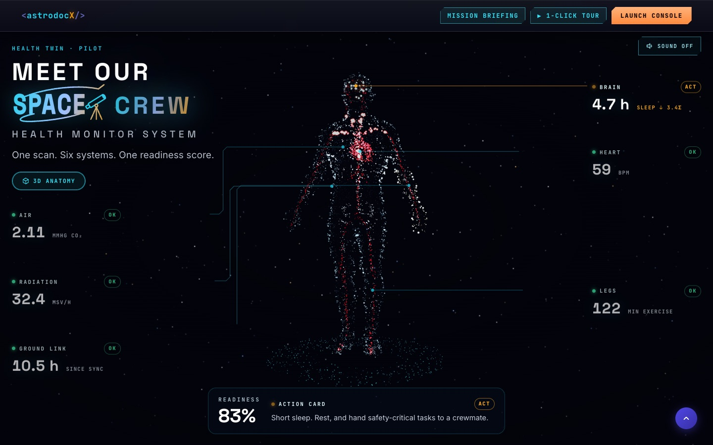

## The problem
Long-duration missions expose astronauts to the five spaceflight hazards NASA groups as **RIDGE**:

- **R**adiation
- **I**solation and confinement
- **D**istance from Earth
- **G**ravity (altered)
- Hostile, closed **E**nvironments

These can bring immune changes, bone and muscle loss, cardiovascular events and behavioral health problems. Beyond the Moon, a message to Earth can take minutes each way, so the crew has to spot these changes in themselves and decide what to do.

## Our solution
AstroDocX learns each astronaut's **personal baseline**, spots drift early, and turns every alert into a **clear action** the crew can take on their own:

**Detect → Explain → Act → Log → Sync later**

| Area | What the Crew Console really does |
|---|---|
| Personal baselines | Learns each astronaut's own normal for 11 metrics (HR, HRV, SpO₂, sleep, exercise, reaction time, mood, CO₂, cabin temperature, noise, radiation dose) with Welford + EWMA; it only learns while nominal, so slow drift is not "learned away" |
| Detection | Smoothed z-scores plus cited absolute limits (NASA-STD-3001 CO₂ and dose), persistence (2–3 readings in a row) and two-signal rules (sleep + reaction); Nominal / Watch / Act with hysteresis |
| Explainable alerts | Each alert says what changed, by how much, against whose baseline and since when, and links the published NASA evidence behind it (OSDR studies with DOIs, Human Research Program reports on NTRS); context, never a diagnosis |
| Action cards | Checkable countermeasure steps with progress and Done; open → escalate → ease → resolve lifecycle, all logged |
| Status Board | Five RIDGE tiles, crew readiness score, crew overview, next action, live vitals strip (ECG-style waves, heart pulse) |
| Crew Doctor (VITA) | VITA reads every crew member's alerts, baselines, readiness, dose and the ground link together: one cabin-wide finding when the same CO₂ or dose alert hits two or more crew, fatigue clusters, triage order and an EVA screen per person, with steps grouped now / today / next link window. Brief, clinical or SBAR ground-handoff wording, read aloud, added to the ground log; an optional live layer (Claude, `/api/doctor`) only re-words that exam, and the server rejects any number or crew member the exam does not contain. In the 3D cabin the VITA robot speaks the same brief |
| Health Twin (console) | A 3D particle body (the same baked human as the landing page) turning gently: the heart beats with the live ECG, a pulse runs down the arteries, and each hazard colours its own part (brain, lungs, legs, skin, transmitter arm) amber or red |
| Trends | 11 charts with the personal baseline band, alert markers, 24 h / 7 d / 30 d |
| Daily Check-in | Opens on an optional face scan (below), then mood, sleep quality, hours slept, 8 symptom chips and a 5-tap reaction test (PVT-style); symptoms and sleep quality raise alerts |
| Face scan (experimental) | A 30-second webcam scan estimates heart rate, breathing and a rough HRV from the tiny colour change of facial skin (remote photoplethysmography, POS method), each with a quality score. The video never leaves the device and only the numbers are kept. A webcam is not a medical sensor: scans are context, never a diagnosis |
| Watch (experimental) | Connect a Haylou Solar 5 smartwatch over Web Bluetooth (Chrome or Edge) for live heart rate and SpO₂, plus its stored stress and sleep history. Nothing is saved unless you switch on *Save watch data on this device*; saved data is linked to one crew member, exportable as CSV or JSON and erasable in one click |
| On-device insights (shadow mode) | From saved watch data, in the Trends screen: a personal anomaly detector (Isolation Forest plus robust z-scores, scored walk-forward), a 24-hour heart-rate forecast band (Holt-Winters), a transparent readiness score and a watch-vs-face-scan agreement check. All of it runs in the browser and is **never wired into the alert engine**, so a wrist artefact cannot raise a medical alert. See the [model card](docs/ml-model-card.md) |
| 3D Cabin | A walk through a lived-in ISS-style module at `/app/cabin`, from the helmet view out to the astronaut on EVA, driven by the console's live data: a crew of six with name tags, the robots VITA and MEDI patrolling the hall, wall screens that run real console pages, a helmet-visor HUD tied to the health monitor, NASA Visible Earth in the window, touch and float-mode controls |
| Guided tour | One link (`/?tour=full`) plays the homepage briefing, the console's main screens with a live CO₂ fault, and the cabin out to the EVA; VITA narrates every stop, captions match the voice, and you can pause, skip or exit at any time |
| Sound | Everything is synthesised in the browser, no audio files: glass-bell interface sounds, Quindar radio tones, generated score beds per screen that duck under speech, and a distinct speaking voice for each crew role, VITA, MEDI and NOVA. One Sound switch per page (remembered in the browser, shared with the homepage); the score is a separate opt-in |
| NASA Library | A curated, searchable library of NASA images, video and audio on astronaut health (six collections: bone and muscle, radiation, sleep and isolation, the Twins Study, life support, spacewalks), pulled live from NASA's Image and Video Library with credit and links |
| Mission Simulator | Mission clock, fast-forward, 4 injectable scenarios (solar event, CO₂ fault, insomnia, deconditioning); watch the engine react |
| Ground Sync | Delay-tolerant outbox: link windows, 12-minute delay, blackout, auto-sync, CSV log export |
| Ground View | Flight-surgeon view rebuilt only from synced entries (shows what Earth knows, and when); each crew card shows the 3D body in its status colour |
| NASA Data | The NASA basis of the console in one screen: for each of NASA's five hazards, what AstroDocX monitors, the NASA-STD-3001 limit it checks and the NASA studies cited; every alert and Status Board tile carries a NASA source tag. Also a **Real crew data** panel: measured blood counts, metabolic and inflammation markers from the four SpaceX Inspiration4 crew (NASA OSDR OSD-569 and OSD-575), each person charted against their own pre-flight baseline and the lab reference range |
| Platform | Offline-first installable PWA, IndexedDB on the device, 4-crew 30-day demo mission preloaded |

**Not built yet (Roadmap):** support for more wearables than the one watch, wearable data feeding the alert engine (today it stays in shadow mode), a real Supabase ground backend with proper policies, vision/SANS self-tests, blood pressure, bone density, a multi-device ground station.

> **Status (8 Nov 2026):** the homepage with its guide NOVA, the **Crew Console** (`app/`) with its 3D Cabin, VITA the crew doctor, face scan, watch link and on-device insights, and the NASA Library are all built and run the full loop. The console passes 496 tests (81 files). AstroDocX is a prototype, **not a medical device**; all thresholds not cited in the code are illustrative. The measured data in the app is the Inspiration4 lab panel on the NASA Data screen, plus whatever you record yourself with the face scan or a connected watch (kept on your device); live vitals, cabin readings and the demo mission are synthetic.

**Two guides, two names.** **NOVA** hosts the homepage briefing and the NASA Library. **VITA** is the crew doctor inside the console and the 3D cabin. **MEDI** is VITA's silent robot helper in the cabin.

## Screenshots
**Landing page:** one scroll-driven journey made of the same 24,000 particles: stardust, a planet, an astronaut saluting the flag on the Moon, Orion, a relay satellite and Earth, which then becomes the Health Twin and finally the AstroDocX wordmark.

| Intro | Crew: on the Moon |
|---|---|
| 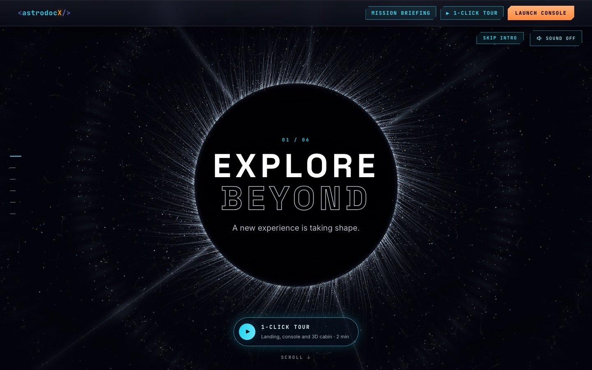 | 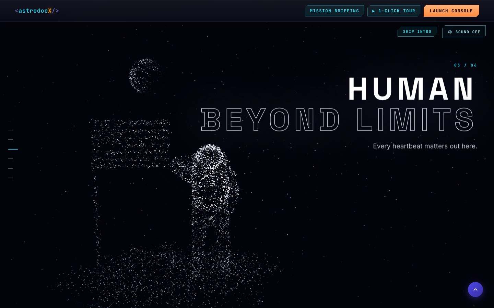 |

| Health Twin | AstroDocX |
|---|---|
|  | 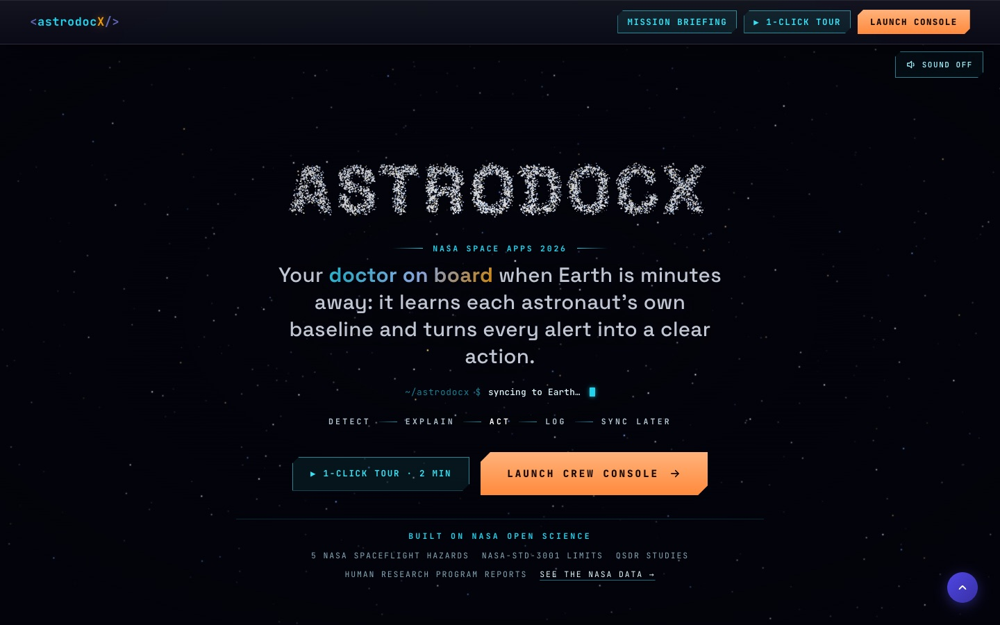 |

**Crew Console** (synthetic demo data, Pilot selected)

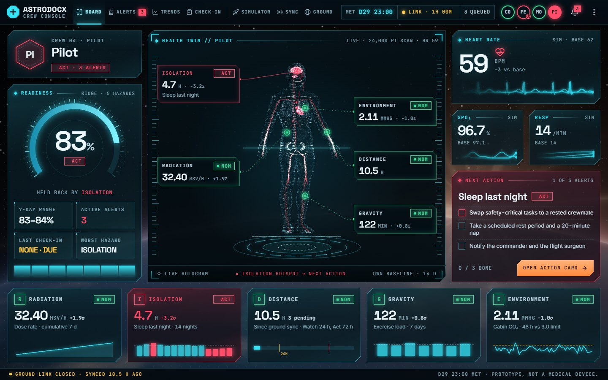

| Alerts | Trends |
|---|---|
| 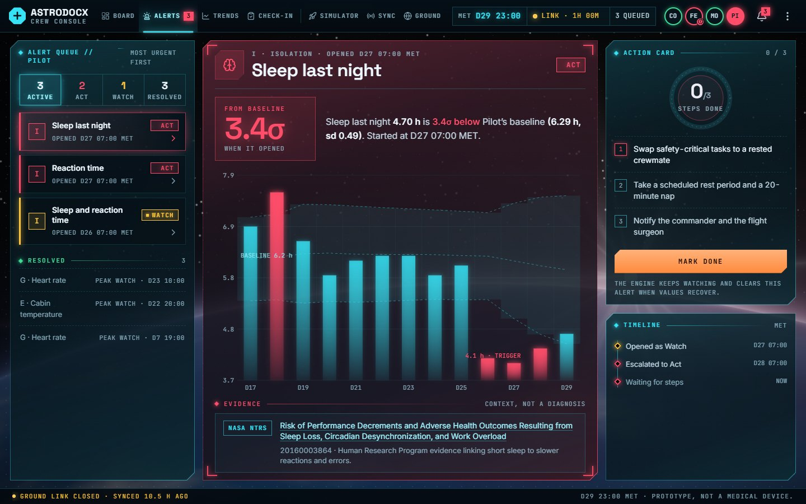 | 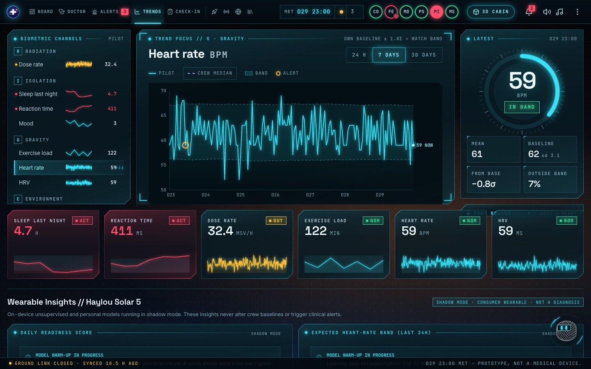 |

| Check-in | Mission control |
|---|---|
| 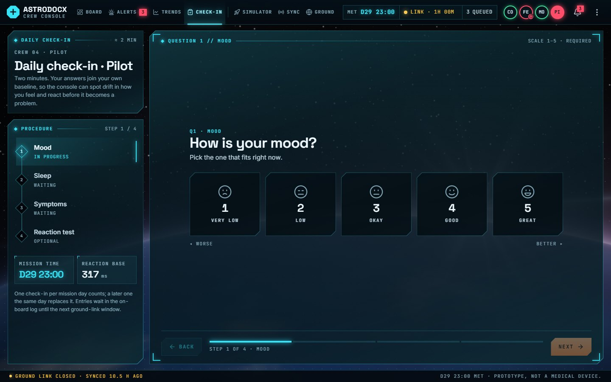 | 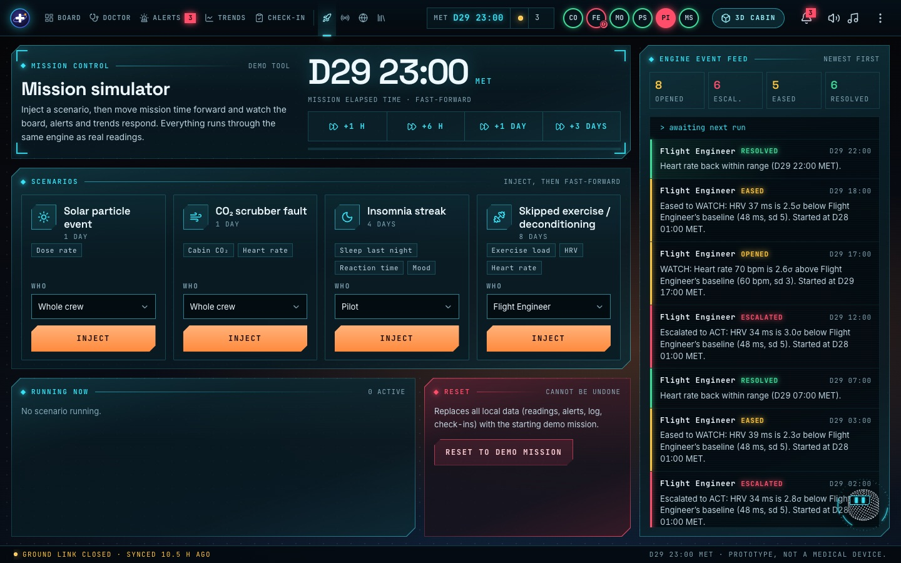 |

| Ground Sync | Ground View |
|---|---|
| 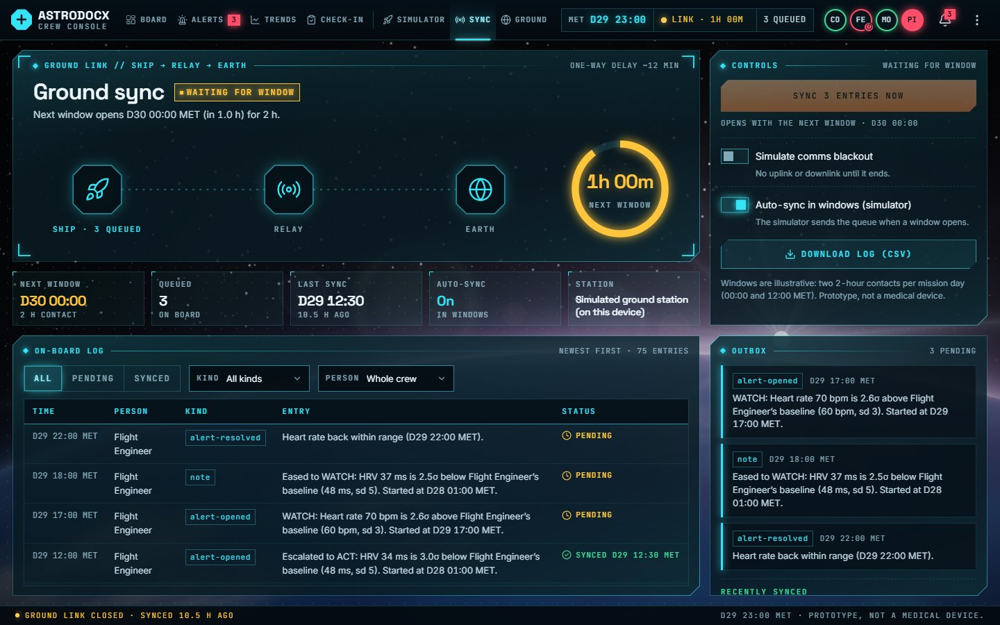 | 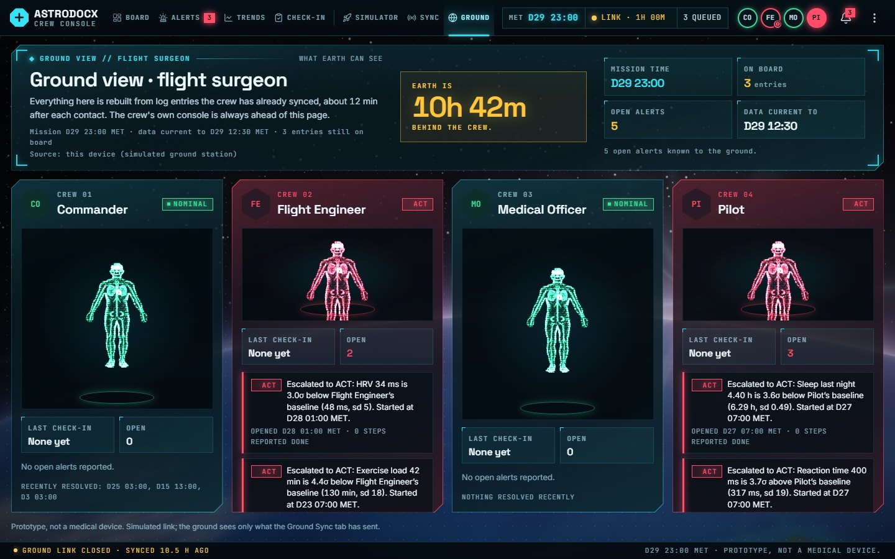 |

The live waves on the board (ECG, pulse oximeter, breathing) are **simulated telemetry** built around the latest real readings; they never change alerts.

## Try it
- **Mission briefing (homepage):** the site opens in a single-screen briefing room hosted by **NOVA**, our mission guide. She gives a 30-second intro (once per visit, with Skip), then answers questions about astronaut health from NASA sources, with citations. Three doors lead to the Crew Console (`/app/`), the 3D Cabin (`/app/cabin`) and the NASA Library. It works offline (built-in answers) and with reduced motion.
- **The story:** the original scroll journey (stardust to Earth, the Health Twin, the AstroDocX reveal) is at [`/story.html`](https://astrodocx.vercel.app/story.html), linked as *Watch the story*.
- **1-click tour:** press *1-click tour* on the homepage (or open [`/?tour=full`](https://astrodocx.vercel.app/?tour=full)) for a guided two-minute run: NOVA's briefing, then the console and the 3D cabin with VITA. Space pauses, Esc exits, a scroll or click pauses so you can look closer.
- **3D Cabin (`/app/cabin`):** scroll to fly from the helmet view through the hall to the EVA; the wall screens are live console pages and the visor HUD follows the selected crew member's status. Works on touch.
- **Crew Doctor (`/app/doctor`):** ask VITA for the cabin-wide exam, switch between Brief, Clinical and SBAR wording, or add the handoff to the ground log.
- **Check-in with face scan (`/app/checkin`):** allow the camera for a 30-second scan, or skip straight to the questions. Use good, even light and sit still.
- **Watch (Status Board, then Trends):** *Connect watch* in the live vitals strip needs a Haylou Solar 5 and a browser with Web Bluetooth (desktop or Android Chrome or Edge, over HTTPS or localhost). The *Watch data* panel and the insights are on the Trends screen. Without a watch, everything else works as before.
- **Health Twin (story page):** scroll through the section. The scan runs head to feet, six system panels appear, Crew Readiness counts up, then the Pilot's real Act alert from the demo mission appears as an action card. Panel values are the demo mission's latest readings.
- **Run demo (Crew Console):** press *Run demo* in the top bar's `⋯` menu to inject a CO₂ scrubber fault and watch the board, twin and alerts react (about 20 s); *Reset demo* restores the mission data.
- **Mission Simulator (Crew Console, `/app/simulator`):** inject a scenario (solar particle event, CO₂ scrubber fault, insomnia streak, skipped exercise) for one crew member or the whole crew, then tick the action-card steps on Alerts and sync the log from Ground Sync in the next link window.

## Links
- **Landing page:** https://astrodocx.vercel.app
- **Crew Console:** https://astrodocx.vercel.app/app/
- **Video:** https://youtu.be/RW1KRrJToUs
- **Repo:** https://github.com/A-42-018/AstroDocX

## Run locally
**Crew Console** (needs Node 22):

```bash
cd app
npm install
npm run dev      # http://localhost:5173/app/
npm test         # 496 tests in 81 files (engine, ML, UI, DB, cabin, doctor)
npm run lint     # oxlint
npm run build && npm run preview   # production build with the service worker, to test install and offline
```

**Landing site** (the briefing homepage, the story page and the NASA Library) is static, with no build step. To run it together with a built console, use the local server, which falls back to the console's `index.html` for deep links such as `/app/cabin`:

```bash
cd app && npm run build && rm -rf ../landing/app && cp -r dist ../landing/app && cd ..
python3 tools/landing-server.py      # http://localhost:5180 (landing at /, console at /app/)
```

For the landing page alone, `cd landing && python3 -m http.server 8000` is enough.

**VITA and NOVA tests** (offline matcher, knowledge builder, live endpoints with a mocked client):

```bash
node --test tools/vita/test/*.test.mjs
python3 -m venv /tmp/vita-py && /tmp/vita-py/bin/pip install -r api/requirements.txt pytest
/tmp/vita-py/bin/python -m pytest tools/vita/test
```

NOVA's and VITA's knowledge base (`knowledge/`) is generated from the engine, the feature table, the tagline and the roadmap line in this README, so keep those three in their current format; how to rebuild it is in [`docs/vita.md`](docs/vita.md).

## Optional: live answers (Claude)
Without any setup, NOVA and VITA answer offline from built-in data. To let them re-word answers live, deploy to Vercel with `ANTHROPIC_API_KEY` set; the Python functions `api/ask.py` and `api/doctor.py` then serve `/api/ask` and `/api/doctor`. Both only re-word cited sources or the console's own exam, and the server rejects invented numbers, crew members and citations. Setup, limits and cost: [`docs/vita.md`](docs/vita.md).

## Optional: real ground server (Supabase)
By default Ground Sync is simulated and nothing leaves the device. To upload synced log entries to a real server, create a Supabase project, run [`docs/supabase.sql`](docs/supabase.sql), copy `app/.env.example` to `app/.env.local` and fill in `VITE_SUPABASE_URL` and `VITE_SUPABASE_ANON_KEY`, then rebuild. Uploads happen only in link windows; a failed upload keeps entries queued like a blackout. The Ground View then reads from the server, so a flight surgeon can open `/app/ground` on another computer. **The provided policies are demo-grade (anonymous insert and read) and only suitable for synthetic data**; see the notes in the SQL file.

## Record the project video (tour mode)
Open the story page with `?tour=1` (for example `http://localhost:8000/story.html?tour=1`; `/?tour=1` forwards there) and it plays the journey by itself, pausing on every scene and Health Twin stage, so a screen recording is smooth. The cursor and back-to-top button are hidden. Options: `&speed=1.25` (faster), `&delay=5` (lead-in seconds). Keys: Space pause, R restart, Esc stop; any mouse wheel or touch also stops it. Check the Space Apps video length rules; hold times per scene are `tour` in `landing/universe/scenes.js`.

## Deploy (Vercel, the live site)
`vercel.json` installs and builds the console in `app/`, copies it to `landing/app/`, and serves `landing/` as the output, with the `/app/*` SPA fallback, security headers and no-cache for `sw.js`. It also deploys the Python functions in `api/` (`/api/ask`, `/api/doctor`). Import the repo in Vercel with the root directory left at the repo root and the framework preset set to **Other**; set **Node.js 22.x** in Project Settings, General. No environment variables are required: without `ANTHROPIC_API_KEY` the live answers return 503 and the guides answer offline (the Ground Server variables in `app/` are optional too).

## Deploy (Netlify)
`netlify.toml` does the static part of the same job (console at `/app/`, landing at `/`, SPA fallback). It does not run the Python functions, so on Netlify NOVA and VITA always answer offline.

## Tech
- Landing page: HTML, CSS and vanilla JavaScript; one WebGL particle system ([Three.js r128](https://threejs.org/)) for the whole page, Health Twin included; [GSAP 3.12 + ScrollTrigger](https://gsap.com/) for the pinned scroll
- 3D shapes are baked offline into small point clouds by dependency-free Node scripts in `tools/`: the Crew scene from the NASA Z2 spacesuit model (right arm re-posed into a salute), the human body carved from a 360° turntable video (visual hull)
- Crew Console: React 19 + TypeScript + Vite PWA, IndexedDB (Dexie), Zustand, Recharts, Vitest; its Health Twin draws the same baked body with plain WebGL (simulated ground sync; Supabase optional)
- 3D Cabin and crew doctor: [three.js](https://threejs.org/) r170 with glTF models loaded on demand (cabin, crew, robots, a Microsoft Rocketbox doctor with script-timed lip sync)
- Sensors: webcam face scan (own rPPG pipeline: POS projection, band-pass, spectral peak), Haylou Solar 5 over the Web Bluetooth API (own frame decoder)
- On-device ML: Isolation Forest, Holt-Winters forecast, ridge regression and Bland-Altman agreement in plain TypeScript with a seeded PRNG; no ML runtime, no network ([model card](docs/ml-model-card.md))
- Sound: Web Audio API synthesis plus the browser's speech engine; no audio assets
- NOVA and VITA: a rule-based offline matcher and exam over a generated knowledge base, plus optional live re-wording by Claude through two Python functions in `api/`

## Project structure
```
AstroDocX/
├── landing/        # landing site (static)
│   ├── index.html  # Mission Briefing homepage: NOVA, the chat and three doors
│   ├── briefing/   # briefing.css (console Holo HUD theme), briefing.js (intro, chat, doors, library overlay),
│   │               #   vita.js (procedural backdrop, the particle drone, door previews), cosmos.js, art.js,
│   │               #   sound.js and voice.js (Web Audio, speech)
│   ├── library/    # NASA Library: library.js (module), collections.json (6 curated collections), tools/ (builder, verifier)
│   ├── vita/       # ask.js (browser client with offline fallback), faq.json (40 offline answers)
│   ├── story.html  # the scroll story: intro -> Health Twin -> AstroDocX
│   ├── styles.css  # story page styles
│   ├── script.js   # story page: nav, typewriter, back-to-top
│   ├── tour.js     # 1-click tour (chapter 1 on either page) and ?tour=1 video mode (story page)
│   ├── universe/   # the particle journey: one canvas for intro -> Health Twin -> AstroDocX
│   │               #   scenes.js (copy + chapter lengths), engine.js (8 shapes), universe.js (director),
│   │               #   health-twin.js, reveal.js (chapter UI), stars.js, camera.js, fx.js, sound.js, universe.css
│   │   └── targets/ # baked point clouds: astronaut.bin (Crew scene), body.bin + body.json (Health Twin)
│   ├── anatomy3d.js # opt-in 3D anatomy viewer (Sketchfab)
│   ├── fonts/
│   └── assets/     # feature mockups, og-image
├── app/            # Crew Console PWA (React + TypeScript + Vite)
│   ├── src/engine/   # baselines, detection, alerts, action cards, NASA limits and evidence (deterministic, tested)
│   ├── src/board, alerts, trends, checkin, sim, sync, ground, nasa/   # the screens
│   ├── src/doctor/   # VITA the crew doctor: exam rules, report wording, 3D doctor and lip sync
│   ├── src/cabin/    # the 3D Cabin: hall, crew, robots, EVA, camera shots, wall screens, visor HUD
│   ├── src/scan/     # face scan (rPPG)       src/watch/   # Haylou Solar 5 over Web Bluetooth + history store
│   ├── src/ml/       # on-device wearable insights (shadow mode)
│   ├── src/audio/    # synthesised effects, score and voices        src/tour/, src/vita/   # guided tour, VITA dock
│   └── public/models/  # glTF models loaded on demand
├── api/            # Vercel Python functions: ask.py (NOVA and VITA answers), doctor.py (crew doctor wording)
├── knowledge/      # generated knowledge base for NOVA and VITA (from the engine, this README and general.json)
├── tools/          # bakers (bake-moon, bake-body, bake-cabin, bake-doctor, bake-i4-labs, bake-particles, undraco),
│   │               #   landing-server.py (local host with the console's SPA fallback)
│   └── vita/       # build-knowledge.mjs and the guide tests
├── docs/           # screenshots, AI_USE.md, DATASETS.md, vita.md, ml-model-card.md, supabase.sql
├── vercel.json     # live deploy (static site + Python functions)
└── netlify.toml    # static-only alternative
```

## Use of AI
Every number, alert, finding and step comes from tested, deterministic code, and so do the face-scan and watch readings and the on-device ML insights (no learned model from outside, no cloud inference). NOVA (the homepage guide) and VITA (the crew doctor) can word their answers live with Claude through `/api/ask` and `/api/doctor`, but only from cited sources or the console's own exam, checked server-side; without a key they answer offline from the same data. Claude Code helped write the code, and Tripo Studio generated the anatomy render behind the Health Twin body. Tools, prompts and the team's own work: [`docs/AI_USE.md`](docs/AI_USE.md).

## NASA data used
AstroDocX is built on NASA science. The console's **NASA Data** screen (`/app/nasa`) lists all of it, hazard by hazard, and every alert names its NASA basis. All of it comes from [`app/src/engine/nasa.ts`](app/src/engine/nasa.ts) and [`app/src/engine/evidence.ts`](app/src/engine/evidence.ts).

| NASA hazard (RIDGE) | AstroDocX monitors | NASA limit checked | NASA evidence cited |
|---|---|---|---|
| **R** · Space Radiation | Dose rate, cumulative dose | NASA-STD-3001 Vol. 1: 250 mSv per solar particle event, 600 mSv career ([technical brief](https://www.nasa.gov/wp-content/uploads/2023/03/radiation-protection-technical-brief-ochmo.pdf)) | OSDR [OSD-993](https://osdr.nasa.gov/bio/repo/data/studies/OSD-993) (space radiation and cell senescence) |
| **I** · Isolation & Confinement | Sleep, mood, reaction time (PVT) | Personal baseline | NTRS [20160003864](https://ntrs.nasa.gov/citations/20160003864) (sleep loss and performance), [20160004365](https://ntrs.nasa.gov/citations/20160004365) (behavioural health) |
| **D** · Distance from Earth | Ground link, unsent data | Watch at 24 h, Act at 72 h without sync (AstroDocX design) | NASA's [five hazards](https://www.nasa.gov/hrp/hazards/) |
| **G** · Gravity Fields | Exercise load, heart rate, HRV | Personal baseline | NTRS [20170005625](https://ntrs.nasa.gov/citations/20170005625) (cardiac rhythm); OSDR [OSD-484](https://osdr.nasa.gov/bio/repo/data/studies/OSD-484) (heart), [OSD-942](https://osdr.nasa.gov/bio/repo/data/studies/OSD-942) (exercise and bed rest) |
| **E** · Hostile/Closed Environments | Cabin CO₂, SpO₂, temperature, noise | NASA-STD-3001 Vol. 2 [V2 6004]: CO₂ 3 mmHg, 1-hour average ([technical brief](https://www.nasa.gov/wp-content/uploads/2023/12/ochmo-tb-004-carbon-dioxide.pdf)) | NTRS [20160012725](https://ntrs.nasa.gov/citations/20160012725) (CO₂ and headaches on the ISS) |

NASA services and programmes used:
- [NASA Human Research Program: the five hazards](https://www.nasa.gov/hrp/hazards/): the RIDGE framework the Status Board and readiness score are organised by
- [NASA Open Science Data Repository (OSDR)](https://osdr.nasa.gov/) and [NASA Technical Reports Server (NTRS)](https://ntrs.nasa.gov/): the studies and reports cited under each alert
- [NASA Office of the Chief Health & Medical Officer](https://www.nasa.gov/ochmo/): NASA-STD-3001 and its technical briefs
- [NASA Human Research Roadmap](https://humanresearchroadmap.nasa.gov/) and the [NASA Twins Study](https://www.nasa.gov/twins-study/)
- [NASA Visible Earth](https://visibleearth.nasa.gov/) (Earth in the 3D cabin) and [NASA 3D Resources](https://science.nasa.gov/3d-resources/) (the landing page's models)

Real astronaut measurements: the console's **Real crew data** panel charts blood, metabolic and inflammation markers from the four Inspiration4 crew (OSD-569 and OSD-575, one impossible source row excluded and disclosed). Every dataset, what we took from it and its licence: [`docs/DATASETS.md`](docs/DATASETS.md).

Other data: [PhysioNet](https://physionet.org/) public physiological signals (ECG / HRV); NASA's [Image and Video Library](https://images.nasa.gov/) for the NASA Library.

Landing-page numbers (the Health Twin panels and Crew Readiness) come from the console's seeded demo mission (synthetic data). Only the CO₂ and dose limits are cited (NASA-STD-3001); other thresholds are illustrative and labelled so. AstroDocX is an independent Space Apps project using NASA open data; it is not affiliated with or endorsed by NASA.

## Credits
The visual theme (nebula, 3D astronaut, scroll system) is adapted from team lead Alif Mahmud's own portfolio template.

3D sources: the Crew scene's astronaut is the NASA Z2 spacesuit from [NASA 3D Resources](https://science.nasa.gov/3d-resources/); the Health Twin body is carved from a turntable render the team made in Tripo Studio. Details and licences: [`landing/universe/targets/README.md`](landing/universe/targets/README.md).

3D Cabin and crew doctor: the module, astronaut, station, consoles and the TARS-style robots are Sketchfab models used under CC BY 4.0 (credited in the cabin's *Credits* button), surfaces are [ambientCG](https://ambientcg.com) (CC0), Earth is from NASA Visible Earth, and the doctor is Microsoft Rocketbox `Medical_Female_02` (MIT, [`app/public/models/doctor.LICENSE.txt`](app/public/models/doctor.LICENSE.txt)).

## License
[MIT](LICENSE)
